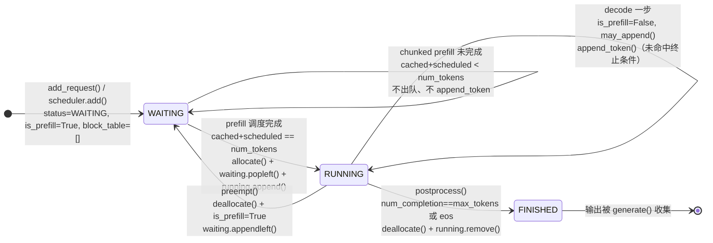
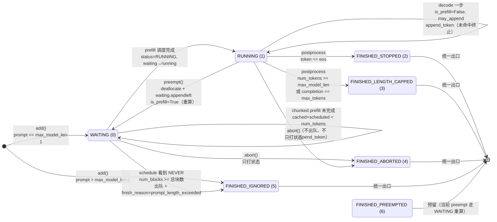
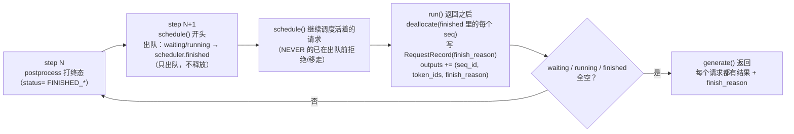

## Nano项目的Seq状态机


![[Seq状态机.excalidraw|1200]]

### 一个seq的PD过程说明状态流转
1.  -> waiting
	 LLM Engine将一条prompt转换为seq，
	 赋予块表、pd状态、token数量等状态
	 **加入到scheduler的waiting队列**
	 
2. waiting - > waiting
	seq数量过长，超过单次处理的seq最大长度
	实施chunked prefill，
	prefill最重要的动作就是写入前序token的KV Cache
	分块处理完，仍然放到waiting

3. waiting -> running
	某个seq进行prefill完成，进入decode环节

4. running -> waiting
	当前某个seq的decode需要新块时，但物理块无空闲时，
	running队尾的seq被premmpt抢占，释放其KV Cache
	需要重新prefill，进行waiting

5. running -> finished
	看到eos或者达到最大长度时，标记为完成

## 边界Case验证
```shell
python -m bench.edge --case a                  # 短请求、比 KV cache 总容量大 1 个 token 的请求、短请求
python -m bench.edge --case b                  # 三个请求跑到第 4 步，running.remove 掉一个（没有 abort 接口）
python -m bench.edge --case c --max-tokens 1   # prompt 恰好等于 max_model_len=4096
python -m bench.edge --case c --max-tokens 2
```

**现象**：

- (a) `can_allocate` 返回 -1，`schedule()` 在 prefill 分支 `break`。排在它**后面**的短请求一步都跑不了（队头阻塞）；前面已经在跑的先跑完，然后走到 decode 分支，`assert scheduled_seqs` 断言失败，整个引擎崩。崩的那一刻 `free_blocks` 是满的。这个请求**永远**放不下，但引擎只知道"现在放不下"。

- (b) 从 `running` 里 remove 之后 block 没有释放，`block_manager.used_block_ids` 漏了；如果它正好在本步被调度，`postprocess` 会拿到它的 token 继续 `append_token`。没有一个状态表示"被取消"。

- (c) `max_tokens=1` 能跑通：prefill 本身就产出第 1 个 token，`postprocess` 当场结束，从不进 decode。`max_tokens=2` 崩：decode 第一步 `len(seq) = 4097`，`may_append` 要第 17 个 block（`len(seq) % block_size == 1`），而 CUDA graph 的 `block_tables` 按 `max_model_len` 只 capture 了 16 列，`model_runner.py` 里拷 `block_tables` 时 `RuntimeError`。入队时没人检查 prompt 长度和 `max_model_len` 的关系。


## 解决和优化
### Case A 状态机优化：分清“永远放不下”和“暂时放不下”
当前scheduler.schedule，
	每次优先看waiting队头seq，看看剩余可处理token数是否能覆盖
导致当单seq的token数 > max_seq_token_num时，
	会长期阻塞prefill -> waiting队列后续的短seq一直无法被拿到


#### 解决方案：扩展Seq的StatusEnum，丰富Finished语义
关键问题在于：
	超长的prompt，在schedule中只被标记为暂时无法处理，
	**而没有特判考虑是否永远无法处理**
	
所以丰富finished语义，保证各种finished情况的seq，在scheduler的队列中都不存在：

```python
class SequenceStatus(IntEnum):
    """请求状态机。

    终态必须全部排在 RUNNING 之后：is_finished 用序比较（>= FINISHED_STOPPED），
    中间不能插非终态。本任务只加类型，任务 B/C 再把终态接进调度器。
    """

    WAITING = 0
    RUNNING = 1
    FINISHED_STOPPED = 2          # 采样到 eos
    FINISHED_LENGTH_CAPPED = 3    # 生成到 max_tokens
    FINISHED_ABORTED = 4          # 客户端取消
    FINISHED_IGNORED = 5          # 入队即拒绝（prompt 太长 / 永远放不下）
    FINISHED_PREEMPTED = 6        # 抢占后不再重算（资源不足）
```

当进行scheduler.schedule时，
	首先将seq.status>=2的seq去掉，
	保证队列中的seq都是正常可运行的

### Case B block回收优化：用户取消的seq，统一到finish语义首先回收统一

关键问题在于：
	没有 `ABORTED`，
	只能 `running.remove()` → `status` 还是 `RUNNING`、`block_table` 没还、`is_finished()` 只看队列所以认为跑完了 
	→ 静默少一条结果 + 2 个 block 永久泄漏。

#### 解决方案
```
同一个 step 的 run 返回之后：
  └─ deallocate(seq1)  → block 回 free list
  └─ RequestRecord(finish_reason="abort")
  └─ outputs += (seq1, 已有的 4 个 token, "abort")
```

### Case C model_len限制优化：入队时增加判断
引擎对单序列长度完全没校验，`max_model_len` 只在 warmup/CUDA Graph 里当预算用。
	prompt=4096, max_tokens=1` 静默生成第 4097 个 token；`
	max_tokens=2` 还要第 17 块，越界。

#### 解决方案
入队: prompt_tokens > max_model_len - 1  → FINISHED_IGNORED
      （4096 > 4095 → 直接拒绝，reason = prompt_length_exceeded）
      给 decode 至少留 1 个位置

生成: postprocess 里 num_tokens >= max_model_len → FINISHED_LENGTH_CAPPED
      （4095 的 prompt 生成第 1 个 token 就到 4096 → 立刻截断）


## 优化更新后的状态机
### Seq的状态流转


![[Seq状态机-优化后.excalidraw|1000]]
### 统一出口

